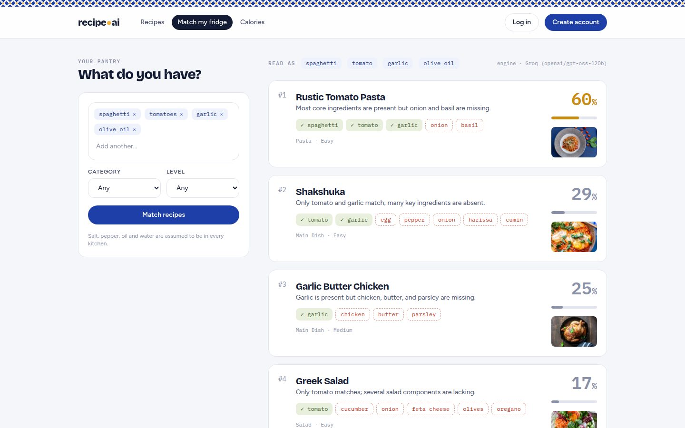
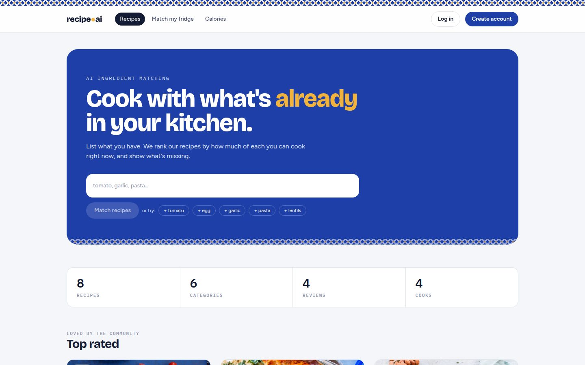
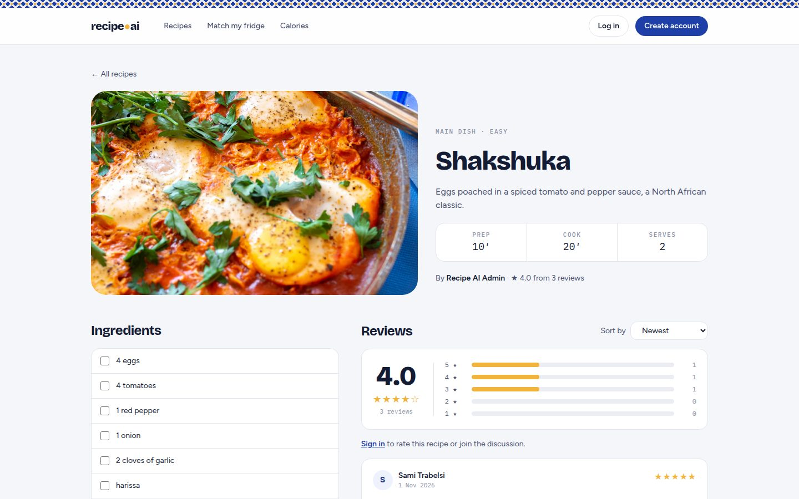
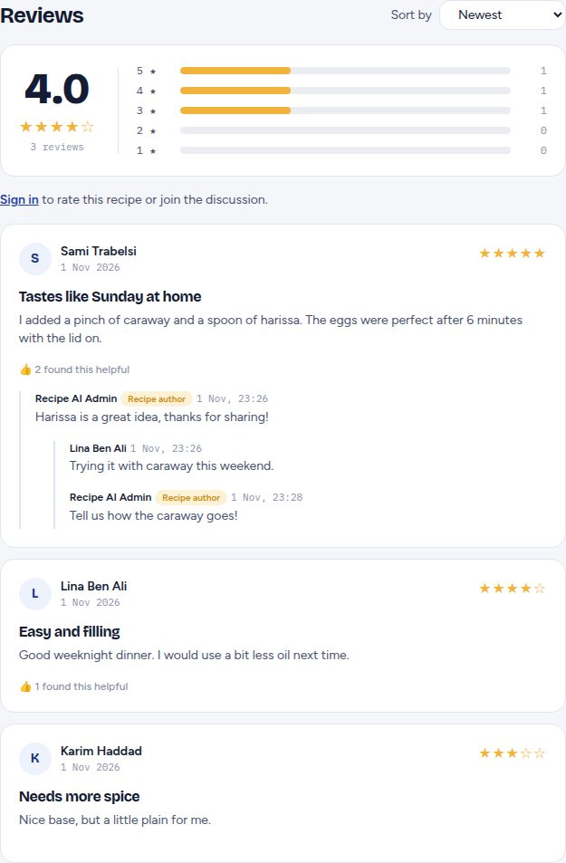
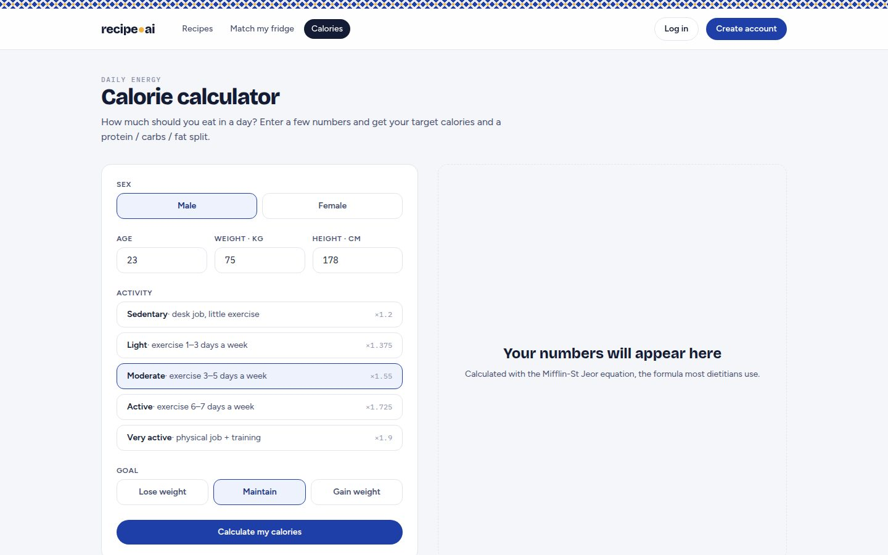
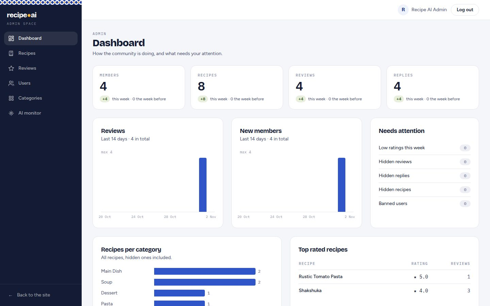
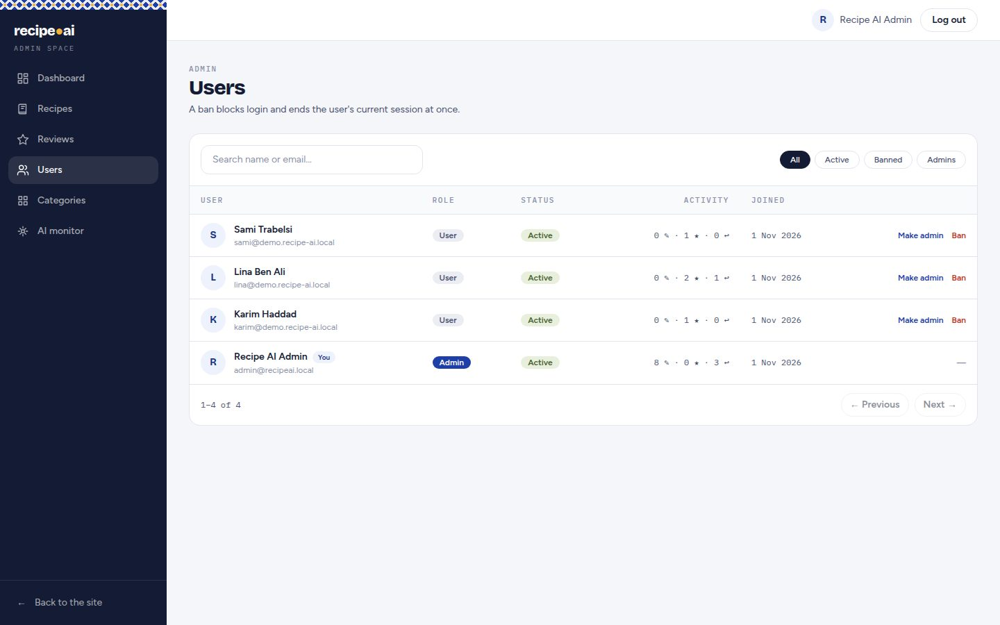
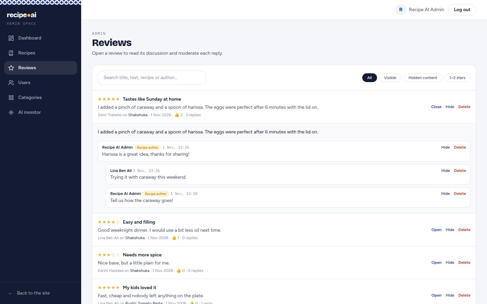
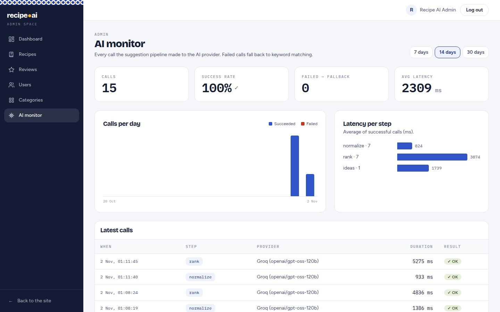

# Recipe AI

**Cook with what's already in your kitchen.** Type the ingredients you have, and an LLM ranks the recipes in the database by how much of each you can cook right now. It shows exactly which ingredients you have and which you'd need to buy, and suggests new ideas when nothing fits.

Built as a full-stack .NET project: **ASP.NET Core 8 Web API · Entity Framework Core 8 · SQL Server 2022 · Identity + JWT · Angular 19 · Groq LLM (swappable provider) · xUnit · Docker**.



| Home: the pantry input is the hero | Recipe page |
|---|---|
|  |  |
| **Reviews:** rating summary, helpful votes, threaded replies | **Calorie calculator** |
|  |  |

### Admin space
| Dashboard: weekly trends, what needs attention | Users: ban (immediate) and roles |
|---|---|
|  |  |
| **Reviews:** moderate each reply inline | **AI monitor:** calls, success rate, latency |
|  |  |

## Features
- **AI ingredient matching:**
  - Ingredients are normalised in any language ("tomates, ail" → tomato, garlic).
  - Recipes are ranked with matched / missing ingredients and a reason.
  - AI recipe ideas appear when nothing matches well.
- **Recipes:** search, category and difficulty filters, paging, create/edit/delete (owner or admin), secure photo upload.
- **Accounts:** register / login with JWT, roles `User` and `Admin`.
- **Reviews:** title + 1–5 stars (one per user, editable), rating summary with a 5→1 histogram, sort, "Helpful" votes, threaded replies with a recipe-author badge.
- **Social:** favorites, notifications ("X rated your recipe 5/5", "Y replied to your review").
- **Calorie calculator:** daily target (Mifflin-St Jeor BMR × activity, goal-adjusted) with a protein / carbs / fat split.
- **Homepage:** live stats, top rated, "ready in 20 minutes", category photo tiles.
- **Admin space** (own layout with a sidebar, admins land there after login):
  - Dashboard: KPIs with weekly trends, "needs attention" (low ratings, hidden content, banned users), reviews and sign-ups per day, recent activity.
  - Recipes, Reviews and Users tables with search, filters and paging; hide/unhide/delete content and each reply.
  - Users: ban/unban (Identity lockout, the user's current token stops working at once), make/remove admin, never on yourself.
  - Categories, and an **AI monitor** (calls per day, success rate, latency per step, latest calls from the AI call log).

## How the AI is made reliable
The LLM is treated as **untrusted input**:

```
user ingredients ──► clean ──► candidates from SQL Server (max 25, filtered)
                                   │
                   LLM: normalise ─┤──► validate (JSON shape, lists, lengths)
                   LLM: rank ──────┤──► validate (only ids we sent, score computed by our code
                                   │      from matched/missing, forgotten recipes keyword-scored)
                   LLM: ideas ─────┘──► validate (max 3, required fields)
                                   │
              any AI failure ──────┴──► keyword fallback, aiAvailable = false (never a 500)
```

- **Provider behind an interface:** `IAiProvider` → `GroqAiProvider` (real LLM) or `OfflineAiProvider` (no network). It's chosen by configuration, so adding Azure OpenAI means one class.
- **Production-grade HTTP:** a typed `HttpClient` (IHttpClientFactory) with the standard resilience handler (retries, timeouts, circuit breaker) and JSON mode.
- **Rate limiting** on the AI endpoint (429), plus logging of every AI call with its duration.
- Names, photos and categories always come **from our database**, never from the model.

## Architecture
Classic layered ASP.NET Core Web API: **`Controller → Service → AppDbContext → SQL Server`**.

```
api/RecipeAi.Api/
├─ Controllers/   HTTP only: routes, [Authorize], status codes
├─ Services/      business rules (ownership, one review per user, notifications...)
├─ Ai/            IAiProvider, Groq + Offline providers, AiResponseValidator, SuggestionService
├─ Models/        EF Core entities (Recipe, Category, Review, Favorite, Notification, AppUser)
├─ Dtos/          API contracts + FluentValidation validators
├─ Data/          AppDbContext, migrations, seed data
├─ Storage/       IFileStorage + LocalFileStorage
├─ Errors/        global exception handler (ProblemDetails), validation filter
└─ Program.cs     dependency injection, auth, CORS, rate limiting, middleware pipeline
api/RecipeAi.Api.Tests/   33 xUnit tests (AI validator, pipeline with fake providers)
web/                      Angular 19 front end (standalone components, signals, lazy routes)
docs/ARCHITECTURE.md      architecture, stack and AI design
```

## Run it
**Prerequisites:** Docker, plus the .NET 8 SDK and Node 20+ for development.

```bash
cp .env.example .env              # fill in the passwords (and optionally GROQ_API_KEY)

# Option A: everything in Docker (SQL Server + API + web behind nginx)
docker compose --profile api up -d --build
# App: http://localhost:8081   API + Swagger: http://localhost:5295/swagger

# Option B: development (database in Docker, API and web locally)
docker compose up -d              # SQL Server only
cd api/RecipeAi.Api
dotnet user-secrets set "ConnectionStrings:Default" "Server=localhost,1433;Database=RecipeAi;User Id=sa;Password=<MSSQL_SA_PASSWORD>;TrustServerCertificate=True"
dotnet user-secrets set "Jwt:Key" "<random string, 32+ chars>"
dotnet user-secrets set "Seed:AdminPassword" "<admin password>"
dotnet user-secrets set "Ai:Groq:ApiKey" "<optional Groq key>"
dotnet run                        # http://localhost:5295/swagger

# Front end
cd web && npm install && npx ng serve   # http://localhost:4200
```

Migrations and seed data (6 categories, 8 recipes, an admin `admin@recipeai.local`) are applied automatically at startup.

```bash
dotnet test                       # 45 tests
```

## CI/CD
GitHub Actions ([.github/workflows/ci-cd.yml](.github/workflows/ci-cd.yml)) runs on every push and pull request:

```
push / PR ─► api:    restore → build → 45 tests (+ coverage) → "migrations up to date?" check
          └► web:    npm ci → ng build (production)
                 └─► images: build recipe-ai-api + recipe-ai-web Docker images
main only ─────────► push images to ghcr.io (tags: commit SHA + latest)
                 └─► deploy: Azure Web App (skipped until configured)
```

- **CI** fails if a test fails, the Angular build breaks, a Dockerfile breaks, or a model changed without a migration.
- **CD** publishes versioned images to GitHub Container Registry with the built-in `GITHUB_TOKEN` (no extra secret).
- **Deploy** turns on when the repository variable `AZURE_WEBAPP_NAME` and the secret `AZURE_WEBAPP_PUBLISH_PROFILE` are set; the `production` environment can require a manual approval.
- **Dependabot** opens weekly update PRs for NuGet, npm, Docker base images and the actions themselves.

## Author
**Youssef Dhouib**, final-year Software Engineering student (AI Engineering), ISIMS Sfax.
